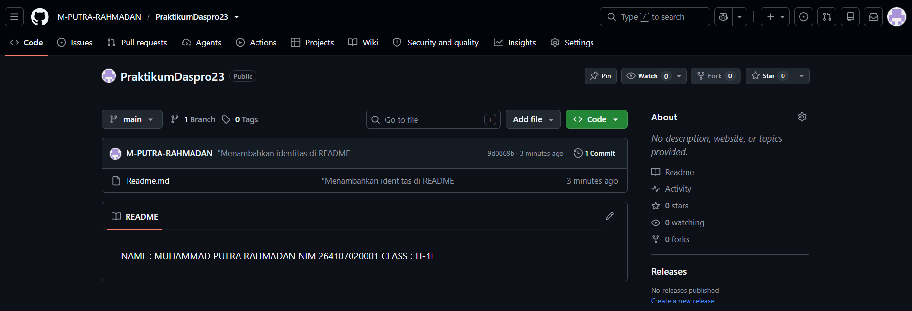

# JOBSHEET 6 - SELECTION CASE STUDIES WITH GIT AND GITHUB

**Student Identity:**
* **Name:** Muhammad Putra Rahmadan
* **Student ID (NIM):** 264107020001
* **Class / Attendance No.:** TI-1I / 23
* **GitHub Repository:** [M-PUTRA-RAHMADAN/PraktikumDaspro23](https://github.com/M-PUTRA-RAHMADAN/PraktikumDaspro23)

## Project Structure

```
PraktikumDaspro23/
├── README.md
├── StudiKasus123.java      (Experiment 2 / Case Study 1 - Basic Selection)
├── StudiKasus223.java      (Experiment 3 / Case Study 2 - Nested Selection)
└── images/                 (screenshots used in this report)
```

---

## 1: PRACTICUM OBJECTIVES

The objectives of this practicum are as follows:

1. Students can solve case studies using basic selection and nested selection structures.
2. Students can save and submit their work using Git and GitHub through Visual Studio Code.
3. Students can collaborate with a friend using GitHub.

---

## 2: EXPERIMENT RESULTS & ANALYSIS

### 2.1 Experiment 1: Preparing the Repository

This experiment prepares the GitHub repository that stores and submits all case studies. The Git operations (clone, add, commit, push, pull) are done with buttons in Visual Studio Code (VS Code). A text command is needed only once, to set the Git identity.

#### 2.1.1 Steps Performed

| Step | Action | Result |
| :---: | :--- | :--- |
| 1 | Create a GitHub account and sign in | Username: `M-PUTRA-RAHMADAN` |
| 2 | Install Git with the default settings (includes Git Credential Manager) | Git detected by VS Code |
| 3 | Set the Git identity with `git config --global user.name` and `user.email` | Commits are credited to my GitHub account |
| 4 | Create the repository `PraktikumDaspro23` (Public, *Add README* = Off) | Empty repository created |
| 5 | Clone the repository: *Clone Git Repository...* → paste the HTTPS URL → *Clone from URL* | Local folder ready in VS Code |
| 6 | Create `README.md` containing name, NIM, and class | File shows status `U` (Untracked) |
| 7 | *Source Control* → click `+` (Stage Changes) | File status changes to `A` (Added) |
| 8 | Write the commit message `Menambahkan identitas di README`, then click *Commit* | New version saved in the local repository |
| 9 | *Push* / *Publish Branch*, then sign in through the browser | `README.md` appears on GitHub |

#### 2.1.2 Output Screenshot
The repository `PraktikumDaspro23` on GitHub after the first push (visibility Public, branch `main`, 1 commit, `README.md` showing my identity):



#### 2.1.3 Git Operations Summary

| Git Process | Function | Button in VS Code |
| :--- | :--- | :--- |
| Clone | Duplicates the GitHub repository to the computer | Welcome → Clone Git Repository → paste URL → Clone from URL |
| Add (Stage) | Selects changes to be committed | Source Control → `+` next to the file |
| Commit | Saves a new version in the local repository | Enter commit message → *Commit* |
| Push | Sends commits from the local repository to GitHub | `...` → Push, or *Publish Branch* / *Sync Changes* |
| Pull | Gets the latest version from GitHub | `...` → Pull |

#### 2.1.4 Analysis
A change goes through three stages: the file is edited (`U` or `M`), staged with *Add* (`A`), and saved as a version with *Commit*. A commit exists only on the local computer until it is sent with *Push*, which is why `README.md` appeared on GitHub only after the push. The Git identity set in step 3 is the name and email recorded as the author of every commit.

---

### 2.2 Experiment 2: Case Study 1 - Basic Selection (Senja Coffee Shop)

#### 2.2.1 Problem Description
Senja Coffee Shop sells *Kopi Susu Gula Aren* for **Rp18,000** per cup and gives a **10% discount** for a purchase of at least **Rp100,000**. The program reads the number of cups and the amount paid, calculates the total price, discount, and final payment, then shows either the change or the shortfall. The program follows the flowchart in the jobsheet.

**Flowchart-to-code mapping:**

| Flowchart | Program variable / statement |
| :--- | :--- |
| `hargaPerCup = 18000` | `int priceperCup = 18000;` |
| `jumlahCup` (input) | `totalcups` |
| `uangBayar` (input) | `payment` |
| `totalHarga = jumlahCup × hargaPerCup`, `diskon = 0` | `total_price = totalcups * priceperCup;`, `discount = 0;` |
| Decision `totalHarga >= 100000 ?` | `if (total_price >= 100000)` |
| `diskon = totalHarga × 10 / 100` | `discount = total_price * 10 / 100;` |
| `totalBayar = totalHarga − diskon` | `total_payment = total_price - discount;` |
| Decision `uangBayar >= totalBayar ?` | `if (payment >= total_payment)` |
| `kembalian = uangBayar − totalBayar` | `change = payment - total_payment;` |
| `kurang = totalBayar − uangBayar` | `shortfall = total_payment - payment;` |

#### 2.2.2 Java Program Code
File: `StudiKasus123.java`

```java
import java.util.Scanner;

public class StudiKasus123 {
    public static void main(String[] args) {
        Scanner sc = new Scanner(System.in);

        // Declaration of variables
        int priceperCup = 18000;
        int total_price;
        double change;
        double discount;
        double shortfall; // matches the "kurang" variable in the flowchart

        // Input data
        System.out.print("How many cups you want to buy: ");
        int totalcups = sc.nextInt();

        System.out.print("Input your payment: ");
        double payment = sc.nextDouble();

        double total_payment;

        // Calculation
        total_price = totalcups * priceperCup;
        discount = 0;

        // Selection using if-else to determine discount
        if (total_price >= 100000) {
            discount = total_price * 10 / 100;
        } else {
            discount = 0;
        }

        total_payment = total_price - discount;

        // Output data from calculation discount and total payment
        System.out.println("Total Price: " + total_price);
        System.out.println("Discount: " + discount);
        System.out.println("Total Payment: " + total_payment);

        // if-else selection to determine change or shortfall
        if (payment >= total_payment) {
            change = payment - total_payment;
            System.out.println("Change: " + change);
        } else {
            shortfall = total_payment - payment;
            System.out.println("Not enough money, shortfall Rp: " + shortfall);
        }

        sc.close();
    }
}
```

#### 2.2.3 Output Screenshot
Output for the jobsheet example input `3` cups and payment `50000`:

```
How many cups you want to buy: 3
Input your payment: 50000
Total Price: 54000
Discount: 0.0
Total Payment: 54000.0
Not enough money, shortfall Rp: 4000.0
```


#### 2.2.4 Test Table

| No | Cups | Payment (Rp) | Total Price (Rp) | Discount (Rp) | Final Payment (Rp) | Output | Status |
| :---: | ---: | ---: | ---: | ---: | ---: | :--- | :---: |
| 1 | 3 | 50,000 | 54,000 | 0 | 54,000 | Shortfall: Rp4,000 | Pass |
| 2 | 6 | 100,000 | 108,000 | 10,800 | 97,200 | Change: Rp2,800 | Pass |
| 3 | 5 | 90,000 | 90,000 | 0 | 90,000 | Change: Rp0 | Pass |
| 4 | 6 | 90,000 | 108,000 | 10,800 | 97,200 | Shortfall: Rp7,200 | Pass |
| 5 | 4 | 75,000 | 72,000 | 0 | 72,000 | Change: Rp3,000 | Pass |
| 6 | 7 | 100,000 | 126,000 | 12,600 | 113,400 | Shortfall: Rp13,400 | Pass |

#### 2.2.5 Git Commits

| No | Commit Message | Content |
| :---: | :--- | :--- |
| 1 | `SK1: input dan deklarasi variabel` | Variable declarations and input of cups and payment |
| 2 | `SK1: logika diskon dan kembalian` | Discount selection, final payment, and change/shortfall selection |

After the code was completed, the commits were sent to GitHub with *Push*.

#### 2.2.6 Analysis
The program uses two independent `if-else` selections. The first decides the discount: six cups cost Rp108,000, which reaches the Rp100,000 threshold, while five cups cost Rp90,000 and receive no discount (test 3). The final payment is the total price minus the discount, and it is calculated after the first selection, just as the flowchart merges both branches before `totalBayar`. The second selection compares the payment with the final payment to show either the change or the shortfall. The flowchart declares `int` variables, while the program uses `double` for the discount, final payment, and change, so the values print with `.0`; the calculation logic is the same. The program can be improved by rejecting a cup quantity of zero or less and a negative payment.

---

### 2.3 Experiment 3: Case Study 2 - Nested Selection (Student Achievement Award)

#### 2.3.1 Problem Description
The Student Affairs Division of Politeknik Negeri Malang validates the completeness of student achievement documents for Activity Year 2026 Phase I. The award funding rules are:

1. **Competition** organized by **BELMAWA, BAKORMA, or Mandiri**: funding is given only to **Rank 1, 2, or 3**.
2. **Student Creativity Program (PKM)**: funding is given to teams that **pass the funding selection**.
3. **Other** activities (**Lainnya**) do not receive funding.
4. Students who meet rule 1 or 2 must upload **4 documents** to SIAKAD (Assignment Letter, Certificate, Activity Photo, Activity Poster). If fewer than 4 are uploaded, the data is incomplete and funding is not given, and the number of missing documents is shown.

The program asks only for the data needed by each activity type and uses nested `if` with a maximum depth of 3 levels.

**Input data:**

| Data | Input rule |
| :--- | :--- |
| Student name | Text |
| Activity type | Text: BELMAWA, BAKORMA, Mandiri, PKM, or Lainnya (case-insensitive) |
| Number of documents uploaded | Number 0-4 |
| Competition rank | Number 1, 2, or 3; enter 0 if not a winner |
| PKM funding status | Number: 1 = passed, 0 = not passed |

#### 2.3.2 Java Program Code
File: `StudiKasus223.java`

```java
import java.util.Scanner;

public class StudiKasus223 {
    public static void main(String[] args) {
        Scanner sc = new Scanner(System.in);

        // Input Name and Activity Type
        System.out.print("Nama mahasiswa : ");
        String nama = sc.nextLine();

        System.out.print("Jenis kegiatan (BELMAWA/BAKORMA/MANDIRI/PKM/LAINNYA) : ");
        String jenisKegiatan = sc.nextLine();

        // Level 1: Check Activity Type
        if (jenisKegiatan.equalsIgnoreCase("BELMAWA") ||
            jenisKegiatan.equalsIgnoreCase("BAKORMA") ||
            jenisKegiatan.equalsIgnoreCase("MANDIRI")) {

            System.out.print("Jumlah dokumen : ");
            int jumlahDokumen = sc.nextInt();

            System.out.print("Peringkat juara : ");
            int peringkat = sc.nextInt();

            // Level 2: Check Competition Rank
            if (peringkat >= 1 && peringkat <= 3) {
                // Level 3: Check Document Completeness
                if (jumlahDokumen == 4) {
                    System.out.println("Status : Dokumen lengkap. Dana penghargaan diberikan.");
                } else {
                    int kurang = 4 - jumlahDokumen;
                    System.out.println("Status : Dokumen tidak lengkap (kurang " + kurang + " dokumen). Dana penghargaan tidak diberikan.");
                }
            } else {
                System.out.println("Status : Bukan juara 1, 2, atau 3. Dana penghargaan tidak diberikan.");
            }

        } else if (jenisKegiatan.equalsIgnoreCase("PKM")) {

            System.out.print("Jumlah dokumen : ");
            int jumlahDokumen = sc.nextInt();

            System.out.print("Status didanai (1=disetujui, 0=tidak) : ");
            int statusDidanai = sc.nextInt();

            // Level 2: Check PKM Funding Status
            if (statusDidanai == 1) {
                // Level 3: Check Document Completeness
                if (jumlahDokumen == 4) {
                    System.out.println("Status : Dokumen lengkap. Dana penghargaan diberikan.");
                } else {
                    int kurang = 4 - jumlahDokumen;
                    System.out.println("Status : Dokumen tidak lengkap (kurang " + kurang + " dokumen). Dana penghargaan tidak diberikan.");
                }
            } else {
                System.out.println("Status : Proposal tidak didanai. Dana penghargaan tidak diberikan.");
            }

        } else if (jenisKegiatan.equalsIgnoreCase("LAINNYA")) {
            // No additional data needed for 'Lainnya'
            System.out.println("Status : Jenis kegiatan tidak termasuk kategori penerima dana penghargaan.");
        } else {
            System.out.println("Status : Jenis kegiatan tidak valid.");
        }

        sc.close();
    }
}
```

**Nesting levels:**

| Level | Condition checked | Used by |
| :---: | :--- | :--- |
| 1 | Activity type (`BELMAWA`/`BAKORMA`/`MANDIRI`, `PKM`, `LAINNYA`, or invalid) | All activities |
| 2 | `peringkat >= 1 && peringkat <= 3` (competition) or `statusDidanai == 1` (PKM) | Competition, PKM |
| 3 | `jumlahDokumen == 4` (document completeness) | Competition, PKM |

The deepest nesting is 3 levels, which meets the jobsheet limit.

#### 2.3.3 Output Screenshot
Output for the jobsheet example input `Dori`, `bakorma`, `3` documents, rank `1`:

```
Nama mahasiswa : Dori
Jenis kegiatan (BELMAWA/BAKORMA/MANDIRI/PKM/LAINNYA) : bakorma
Jumlah dokumen : 3
Peringkat juara : 1
Status : Dokumen tidak lengkap (kurang 1 dokumen). Dana penghargaan tidak diberikan.
```


#### 2.3.4 Test Table

| No | Activity | Documents | Rank / Funding | Output | Status |
| :---: | :--- | :---: | :--- | :--- | :---: |
| 1 | BAKORMA | 3 | Rank 1 | Documents incomplete (1 missing); no funding | Pass |
| 2 | Mandiri | 4 | 0 (not a winner) | Not Rank 1, 2, or 3; no funding | Pass |
| 3 | pkm | 4 | 1 (passed) | Documents complete; funding granted | Pass |
| 4 | Lainnya | - (not asked) | - (not asked) | Activity type is not eligible; no funding | Pass |
| 5 | BELMAWA | 4 | Rank 1 | Documents complete; funding granted | Pass |
| 6 | PKM | 2 | 1 (passed) | Documents incomplete (2 missing); no funding | Pass |
| 7 | PKM | 4 | 0 (not passed) | Proposal not funded; no funding | Pass |
| 8 | Seminar | - (not asked) | - (not asked) | Invalid activity type | Pass |

#### 2.3.5 Git Commits

| No | Commit Message | Content |
| :---: | :--- | :--- |
| 1 | `SK2: cabang lomba` | Competition branch (BELMAWA, BAKORMA, Mandiri) |
| 2 | `SK2: cabang PKM dan lainnya` | PKM branch, Lainnya, and invalid activity type |

After the code was completed, the commits were sent to GitHub with *Push*.

#### 2.3.6 Analysis
The program uses nested selection because a student reaches a later check only after passing the earlier one. The activity type (level 1) decides which extra data is requested, so `Lainnya` and invalid types never ask for documents, rank, or funding status. The rank or funding status (level 2) is checked before document completeness (level 3), so the result shows the first requirement that failed. `equalsIgnoreCase()` makes `pkm`, `PKM`, and `Pkm` equivalent. The number of missing documents is calculated as `4 - jumlahDokumen`. Because the check is `jumlahDokumen == 4`, a value above 4 would produce a negative "missing" count; the jobsheet limits the input to 0-4, but using `jumlahDokumen >= 4` and validating the input range would make the program safer.

---

### 2.4 Experiment 4: Cross-Testing a Friend's Program

GitHub is also used to collaborate on a shared project. In this experiment, each student in a pair tests the friend's program, and the friend tests mine.

#### 2.4.1 Steps

| Role | Step | Action |
| :--- | :---: | :--- |
| Repository owner | 1 | *Settings → Collaborators → Add people*, enter the friend's GitHub username, click *Add to repository* |
| Invited student | 2 | Open the invitation email and click *Accept invitation* |
| Invited student | 3 | Copy the HTTPS URL of the friend's repository and clone it in VS Code |
| Invited student | 4 | Run `StudiKasus2<NoPresensi>.java` with at least 3 test data, write the results at the bottom of `README.md`, then *Add* and *Commit & Push* with the message `Hasil uji SK2 oleh <Nama>` |
| Repository owner | 5 | *Pull* (or *Sync Changes*) to get the friend's commit, then check that the test results appear in `README.md`; fix the program if any result does not match, then *Commit & Push* |
| Repository owner | 6 | Open the repository on GitHub, click *Commits*, and confirm the friend's commit is listed |

**Note:** the repository owner must *Pull* before editing `README.md`, to avoid a conflict from two people changing the same file.

#### 2.4.2 Analysis
Cross-testing shows how a second person finds mistakes the author may miss, such as a result that does not match the rules in the problem. *Pull* brings the friend's commit into my local repository, and the commit history on GitHub records who changed what and when. The friend's test results for my program are appended at the bottom of this file.

---

## 3: CONCLUSION

Basic selection (`if-else`) decides one of two outcomes, as in the coffee shop program where the purchase either qualifies for a discount or not, and the payment is either enough or not. Nested selection checks conditions in stages, so an inner condition is evaluated only when the outer one is met; this suits the achievement award case, where the activity type, rank or funding status, and document completeness must be checked in order, and it allows a specific reason for each failure. Using Git and GitHub through VS Code, the work was saved in small commits with clear messages (*Add → Commit*), sent to GitHub with *Push*, and shared with a friend through collaborators and *Pull*. Testing with several input combinations, including boundary and invalid inputs, confirmed the expected behavior and revealed where input validation should be added.

---

## Hasil Uji Studi Kasus 2 oleh <Fauz Dino>

| No | Jenis | Dokumen | Juara/Dana | Output | Sesuai? |
|----|-------|---------|------------|---------|---------|
| 1 | BAKORMA | 3 | Juara 1 | Dokumen tidak lengkap (kurang 1 dokumen). Dana penghargaan tidak diberikan. | Ya |
| 2 | Mandiri | 4 | 0 (bukan juara) | Bukan juara 1, 2, atau 3. Dana penghargaan tidak diberikan. | Ya |
| 3 | PKM | 4 | 1 (didanai) | Dokumen lengkap. Dana penghargaan diberikan. | Ya |
| 4 | PKM | 2 | 1 (didanai) | Dokumen tidak lengkap (kurang 2 dokumen). Dana penghargaan tidak diberikan. | Ya |
| 5 | Lainnya | - | - | Jenis kegiatan tidak termasuk kategori penerima dana penghargaan. | Ya |
